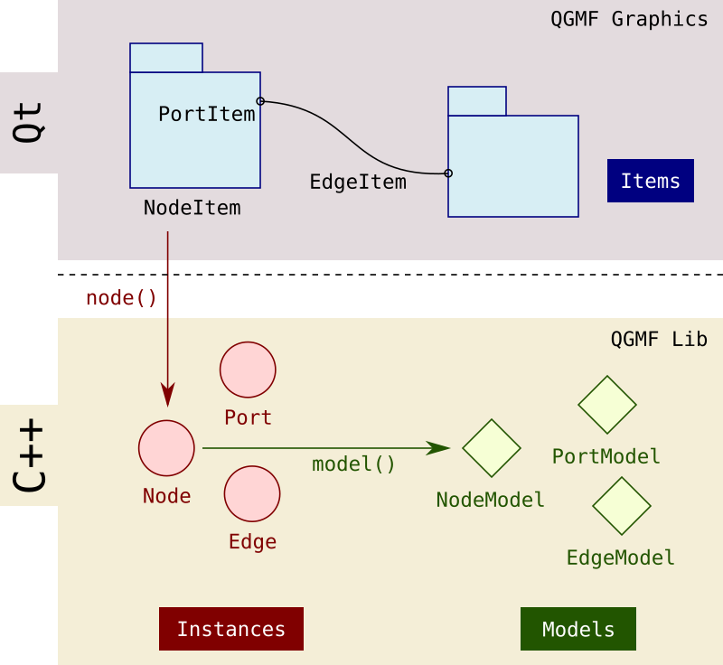
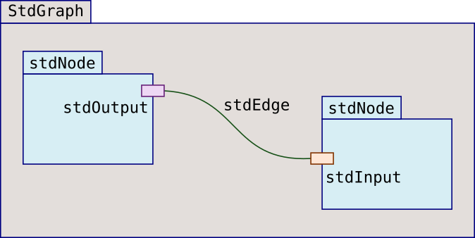
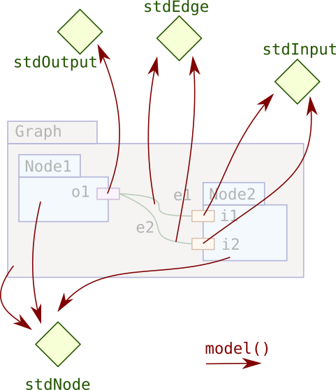
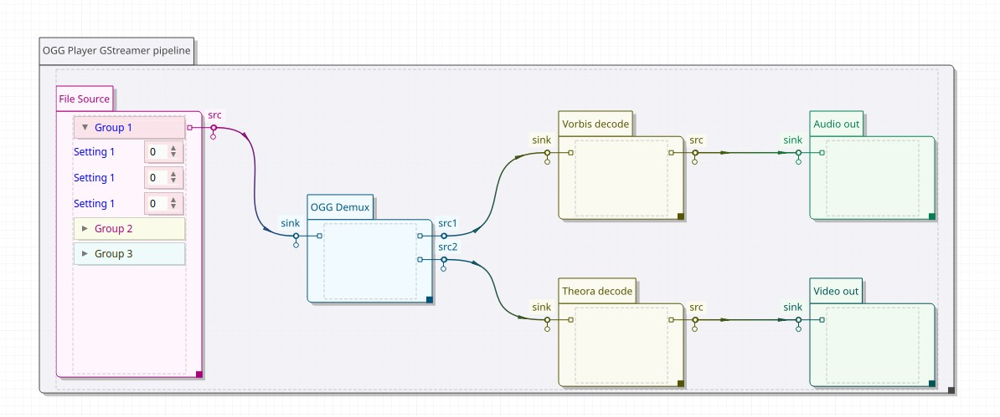
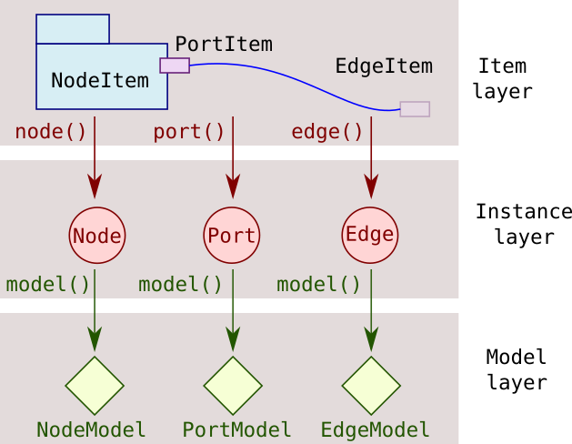
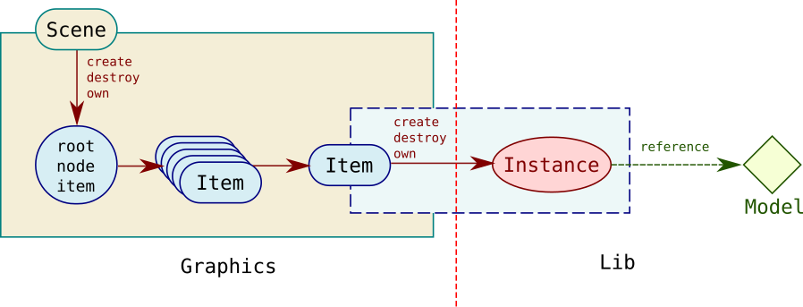
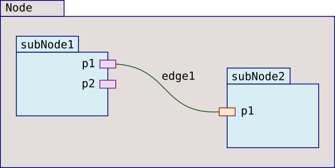

.. _archi:

Architecture
============

QGMF code is split into two entities:

* The QGMF library: a C++ only code that provides :ref:`models` and
  :ref:`instances`
* The QMGF graphics library: a Qt code that provides :ref:`items`

.. _models:

Models
------

A **model** can be seen as a type
or kind for which you can have multiple instances of it. It is
analogous to a class in programming languages.

QGMF has support for the following models:

* ``NodeModel``. The models for nodes
* ``PortModel``. The models for ports
* ``EdgeModel``. The models for edges (i.e. connections)
* ``GraphModel``. Same as ``NodeModel``. In QGMF, graphs are nodes
  except that in programming syntax, we don't allow ports and
  edges on them.

For most common graphs, a single model of nodes is enough because you
design graphs that process the same kind of data, so the nodes are of
the same nature. But you may also want to distinguish multiple node
types because either they don't manage the same type of data or have
different properties by nature.

Think for instance of a video processing pipeline in which you would
like to make the difference between *audio* and *video*
nodes. Moreover, you don't want the output of a video node to go to
the input of an audio node, so you also need two kind of edges: one
that transports audio streams and another that transports video
streams. The same goes for ports, in which we distinguish between
audio and video ports, because you don't want to put an audio port in
a video node. Also, you don't want to connect two video ports
arbitrarily: a video edge model must necessarily have an output video
port as its source and an input video port as its target so two kinds
of ports are needed: input and output ports, for both audio and video.

In addition to allowing multiple models for nodes, ports and edges,
QGMF has built-in support to express the following constraints on
them:

* Express what models of subnodes a node can hold
* Express what models of ports a node can hold
* Express what models of ports an edge can connect
* Express what models of edges a node can hold

For other constraints, QGMF offers intuitive APIs like
``canAddEdge()``, ``canAddPort()`` and so on that you can reimplement to
fit your needs and express complex conditions.

In any case, QGMF will not allow the construction of graphs that violates
the constraints of their models.

Models are read only entities. They can be queried for capabilities or
properties but never modified.

.. _std-model:

Standard Model
~~~~~~~~~~~~~~

QGMF comes with a *Standard Model* that will fit most visualization
needs because of its genericity and low constraints. It has the
following models:

* ``stdNode`` The standard node model. Can hold standard input and
  output ports and has no support for subnodes.
* ``stdInput`` The standard input port model.
* ``stdOutput`` The standard output port model.
* ``stdEdge`` The standard edge model.
* ``stdGraph`` The standard graph model. Holds standard nodes linked
  with standard edges.

and the following constraints:

* Cannot link an input and output port of the same node

Here is an illustration of a graph built using the Standard Model.

.. _instances:

Instances
---------

Instances are the nodes, edges and ports effectively created to form
the graph using the ``addNode()`` and similar calls. Every instance is
*linked* to its model at intanciation time which can be returned by
the ``model()`` call.

.. warning::
   Multiple instances can share the same model (e.g. multiple input
   ports). As such, it is wrong to put data in the model with the hope
   that each instance will get its own copy.
   Think of models as containing only "static" members in C++.
   

QGMF allows to attach arbitrary data to each instance using ``setData()``
and retrived using ``data()`` calls.

.. warning:: If you intend to visualize a graph, it must be created
             through the graphics library. It is not possible to pass
             an existing graph to QGMF graphics.

.. _items:

Items
-----

Items are the graphical representation of instances. Unlike models and
instances which are provided by QGMF library, items are provided by
the QGMF graphics library. Each graph item has its counterpart
instance. Other items not related to the graph are simple graphic items.

QGMF extends the ``QPainterPath`` from Qt to build the ``QGMF::Item``
class with the following capabilities:

* Items can have states (like hovered, toggled, ...) with propagation
  ability to children and/or parent
* Styling is provided for all items on a per state basis. Color can be set
  individually for both outline and fill.
* Animations are provided for all items and can be individually
  enabled for the following changes:
  
  * Position
  * Style
  * Scale

QGMF also provides base classes for nodes, edges and ports to support
common graphic item operations like edge pulling. But as many graphic
operations depend on the item shape itself, it is hard to go beyond a
very minimal common implementation.

For instance, the ``NodeItem``, ``PortItem`` and ``EdgeItem`` classes
of QGMF provide no shape at all. This has the consequence of providing
no user interactions too because of their dependency to the shape.

Fortunately, the :ref:`std-items` built-in implementation takes care
of providing reasonable graphical representations and interations for
the graph. By default, QGMF will use its built-in Standard Items
implementation when rendering the graph, but other custom
implementations can be used too by passing them to the QGMF's scene at
construction time. These implementations are called :ref:`item-factory`.

.. _std-items:

Standard Items
~~~~~~~~~~~~~~

QGMF comes with ready to use representations for nodes, edges and
ports that are suitable to visualize nodes as "boxes" linked
together. Standard Items have the following capabilities:

    
* For Node items
  
  * Node items have a box body shape with a caption, with distinct styling for
    body and caption
  * Node body is freely resizable
  * Input port items are on the left, output ports are on the right and
    bidirectional ports are on the bottom of the node
  * Ports are movable along node body, with collision avoidance and
    body growth if necessary
  * Node bodies have a scrollable *content* item, in which subnodes are
    shown. The content can also be used to show en embedded QWidget.
  * ``sizeHint()`` call to determine a best fit node size
    
* For Port items
  
  * Ports have a caption, with distinct styling for body and caption
  * Ports show distinct connection points for each incoming or outgoing
    edge
    
* For Edge items
  
  * Animated new edge pull and retarget (source or destination)

Here is a screenshot of a graph visualization that uses the Standard
Items.

.. _relationships:

Access & Ownership
------------------

When setting up a graph it is important to know which API level to
use, how objects from graphics, instances and models are structured
together and what are their lifetime.

Graphical vs Headless modes
~~~~~~~~~~~~~~~~~~~~~~~~~~~

There are two APIs that can be used to build graphs in QGMF:

* The *library* API. Located at the QGMF library level, it is a pure
  C++ API that can be used to build graphs **that are not targeted for
  visualization**.

  When QGMF is used like this, it is called *headless* mode, and your
  project does not need to link agains QGMF graphics not does it
  require Qt.

* The *graphics* API. Located at the QGMF graphics library level, it
  is a Qt API used to build graphs that are to be visualized on a
  scene.

  When QGMF is used like this, your project needs to links against
  both QGMF library and QGMF graphics and will require Qt libraries to
  run too.

Except aspects related to graphics stuff, the two API exhibit similar
calls. For instance, one can add a node using ``addNode()`` from QGMF
lib and ``addNodeItem()`` from QGMF graphics. Other such examples
include iterating over ports using either ``ports()`` or
``portItems()``, with the difference that the library call will return
a ``std::list`` result whereas its gprahics counterpart will return a
``QList`` result.

Access
~~~~~~

Once the API level chosen, API calls always flow from top to
bottom. Consequently:

* A model has no knowledge about the instances that links to it
* An instance has no knowledge about its item

The topdown approach allows:

* An item to access its instance
* The instance to access its model

Here is how the API is split into these layers:

            
When in the same layer, it is possible to access sibling objects. For
instance, in the instance layer, a node *instance* can reach its
parent node *instance* or its child nodes *instances*. In the items
layer, an edge *item* can reach both its source and destination port
*items*, which in their turn can reach their node *items*, and so on...

Ownership
~~~~~~~~~

When a graph is created using the QGMF API (either lib or graphics),
the resulting objects (nodes or node items, ports or port items, ...)
have determined ownership. In QGMF, new objects are created from the
owning object (e.g. a subnode is created from the parent node, a port
is created from the node, ...) which is also responsible of their
destruction when it is removed.

When using the graphics API, the item classes take care of creating,
managing and destroying the unerlying instances in the lib
layer. Despite the instances can be accessed from graphics layer, they
are exposed as *read only* objects. All changes to the graph must be
done through the graphics API because there is no way back from the
library layer to the graphics layer.

The lifetime of the created objects is automatically managed. For
instance, removing a node will resursively remove all of its subnodes,
edges and ports. If removing a node item, this will recursively remove
all of its subnode items, edge items and ports items, in addition to
removing also all the instances that are attached to these graphic
items.

Regarding models, these are objects that are statically allocated and
are always present. They are constant and cannot be changed.

This is depicted the figure below:

.. note:: In the remaining of this documentation, we will stop
          differenciating *items* and *instances* (node items and
          nodes, ...) unless it is necessary.

For the graph itself, the ownership is as follows:

* A node owns its subnodes
* A node owns its ports
* A node owns edges that link between two of its subnodes

In this figure:

* ``Node`` owns ``subNode1`` and ``subNode2``
* ``Node`` owns ``edge1``
* ``subNode1`` owns ``p1`` and ``p2``
* ``subNode2`` owns ``p1``
