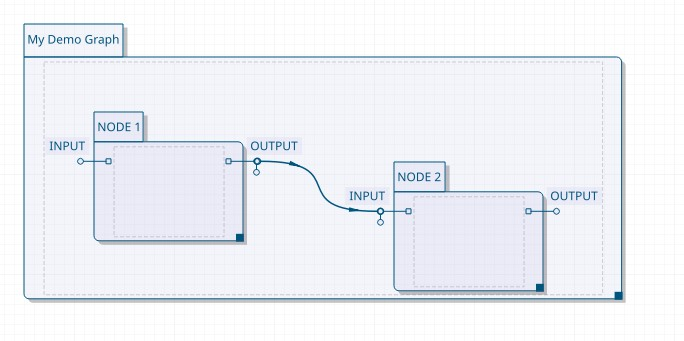

.. highlight:: shell

.. _overview:

Overview
========

Welcome to **QGMF**, the Qt Graph Modeling Framework.

QGMF is a **library** that allows you to build and visualize **graphs** in
Qt applications. It relies on the `Qt Graphics Framework
<https://doc.qt.io/qt-5/graphicsview.html>`_.

.. note:: QGMF is not a product of The Qt Company.

Here is what you can get using only calls to QGMF builtins:

.. figure:: images/screenshot1.jpeg

.. _features:

Features
--------

- Ready to use: immediately build and visualize
- User interactions and animations
- Intuitive and uniform API
- Visualization-less mode
- Hierarchical graph support

The following do not come with QGMF:

- Graph builder application: graphs are built in C++.
- Automatic node placement

.. _source-build:

Build
-----

QGMF is hosted on Github and uses the Qt QMake build system::

  git clone https://github.com/DexterMagnific/QGMF.git
  cd QGMF
  mkdir build
  cd build
  qmake CONFIG+=release ..
  make

The build will produce two libraries in ``lib/`` and ``graphics/`` directories.
You need to link against them to use QGMF in your application.

.. _first-graph:

Your first graph
================

Before going into details, let's see what can be done with QGMF. In this
section, we will learn:

- How to build a graph for visualization, in C++
- Well that's all 

The Qt app
----------

We need to make a simple Qt app that will display the graph. Let's start by
creating a directory:

.. code-block:: shell

   mkdir MyQGMFDemo

Now we need a main window for our app:

.. code-block:: c++

  #include <QApplication>
  #include <MyDemoWindow.h>

  // main.cpp
  int main(int argc, char *argv[]) {
    QApplication a(argc, argv);
    MyDemoWindow w(nullptr);
    w.show();
    return a.exec();
  }

The visualization window
------------------------

To visualize a graph, you need both a ``QGMF::View`` and a
``QGMF::Scene``. Let's put these inside the main window.

.. code-block:: c++
   :emphasize-lines: 5,14-15

   // MyDemoWindow.h
   #pragma once

   #include <QMainWindow>
   #include <QGMFGraphics.h>

   class MyDemoWindow : public QMainWindow
   {
      public:
        explicit MyDemoWindow(QWidget *parent = nullptr);
        ~MyDemoWindow() = default;

      private:
        QGMF::View *view;
        QGMF::Scene *scene;
   };

.. note::
   * QGMF visualization needs a single header ``QGMFGraphics.h``
   * QGMF API is located inside ``QGMF`` namespace

.. warning::
   * Regular Qt Graphics Framework scenes and views **cannot** be used to
     build and show QGMF graphs. However, they are base classes for QGMF's
     scenes and views, and any standard Qt Graphics item can be put on a QGMF
     scene.

Let's now begin immediately with creating the view and the scene:

.. code-block:: c++

   // MyDemoWindow.cpp

   #include "MyDemoWindow.h"

   MyDemoWindow::MyDemoWindow(QWidget *parent)
      : QMainWindow(parent)
   {
      // You need a view to visualize the graph
      view = new QGMF::View(this);
      setCentralWidget(view);

      // You need a scene to create your graph
      scene = new QGMF::Scene(0,0,1000,500,           // the scene rect
                              QGMF::stdGraph,         // the graph model
                              "My Demo Graph",        // the graph name
                              nullptr,                // the item factory
                              this);

      // Attach the scene to the view
      view->setScene(scene);

      // Populate graph here ....
   }

.. note::
   * For now, we won't be talking about **Graph Model** and **Item factory**.
     Just have in mind that QGMF supplies defaults for these two which are
     sufficient for this demo and for many cases.

The graph
---------

Now let's populate our graph.

.. code-block:: c++

   // Grab your graph's top level (root) item.
   QGMF::GraphItem *root = scene->graphItem();

   // Add a first node
   QGMF::NodeItem *node1 = root->addNodeItem(QGMF::stdNode, "NODE 1");

   // Add an input and output ports for NODE 1
   QGMF::PortItem *node1_input  = node1->addPortItem(QGMF::stdPort, "INPUT");
   QGMF::PortItem *node1_output = node1->addPortItem(QGMF::stdPort, "OUTPUT");

   // Add a second node
   QGMF::NodeItem *node2 = root->addNodeItem(QGMF::stdNode, "NODE 2");

   // Add an input and output ports for NODE 2
   QGMF::PortItem *node2_input  = node2->addPortItem(QGMF::stdPort, "INPUT");
   QGMF::PortItem *node2_output = node2->addPortItem(QGMF::stdPort, "OUTPUT");
   
.. note::
   * The **item factory** is responsible of node, edge, port shaping and
     positionning, as well as various graphics interactions

.. note::
   * The QGMF supplied standard factory can automatically place ports on nodes,
     but has no support for node placement

Now we can link ports together:

.. code-block:: c++

   root->addEdgeItem(QGMF::stdConnection, node1_output, node2_input);

Let's nicely position our nodes manually. If we were on a fully featured
application, we would have read positions from a save file.

.. code-block:: c++

   root->setPos(50,50);
   node1->setPos(50,50);
   node2->setPos(150,0);
          

And voilà !

.. note::
   Did you notice that the edge between ``node1`` and ``node2`` has been added
   as part of the ``root`` node ?

.. warning::
   * Edges belong to the parent node of both the nodes they link.

.. note:: Did you notice that we already have built a hierarchical graph ?
          We put two nodes inside another one (the root node).
          
Let's make our graph show all of its contents:

.. code-block:: c++

   root->resize(root->sizeHint());

The package
-----------

Now let's package everything. We need a ``.pro`` file to build everything:

.. code-block::

   # MyQGMFDemo.pro

   TEMPLATE = app
   TARGET = MyQGMFDemo
   
   QT += widgets
   
   QMAKE_CXXFLAGS += -std=c++17
   
   INCLUDEPATH += /path/to/QGMF/lib
   INCLUDEPATH += /path/to/QGMF/graphics
   
   LIBS += -L/path/to/QGMF/build/lib -lQGMF
   LIBS += -L/path/to/QGMF/build/graphics -lQGMFGraphics

   SOURCES += \
     MyDemoWindow.cpp \
     main.cpp
   
   HEADERS += \
     MyDemoWindow.h

.. note:: Don't forget to adjust the path to QGMF build dir above

Now let's build:

.. code-block:: shell

   mkdir build
   cd build
   qmake ..
   make

And run:

.. code-block:: shell

   LD_LIBRARY_PATH=/path/to/QGMF/build/lib:/path/to/QGMF/build/graphics ./MyQGMFDemo

Wonderful !

